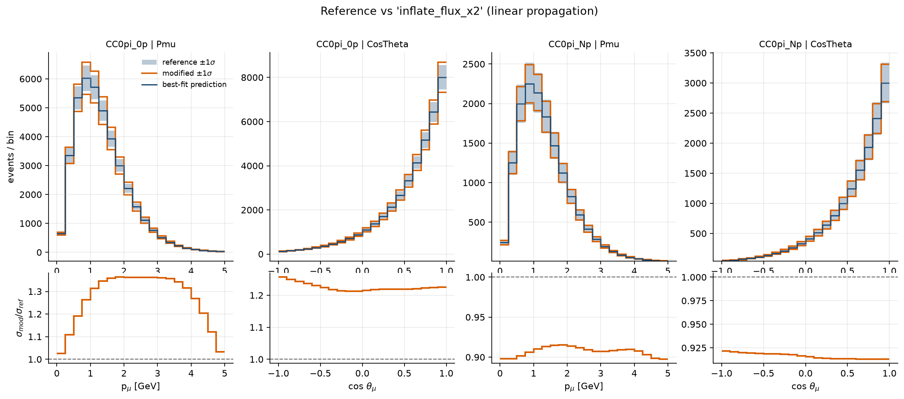
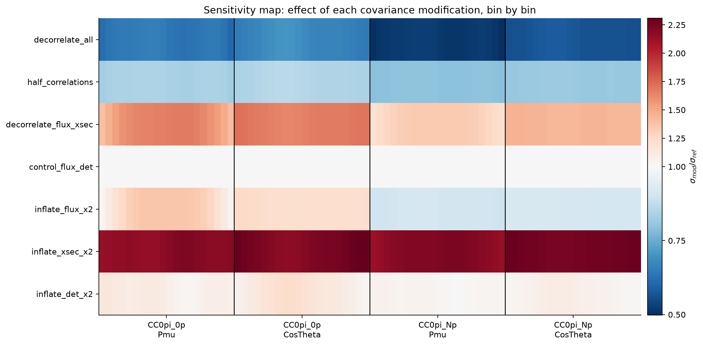
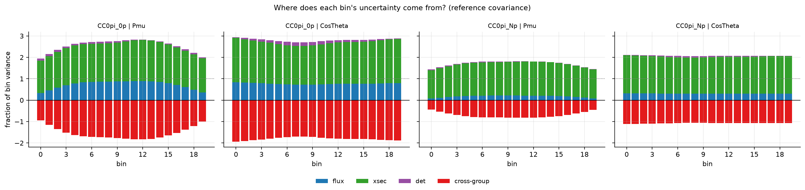
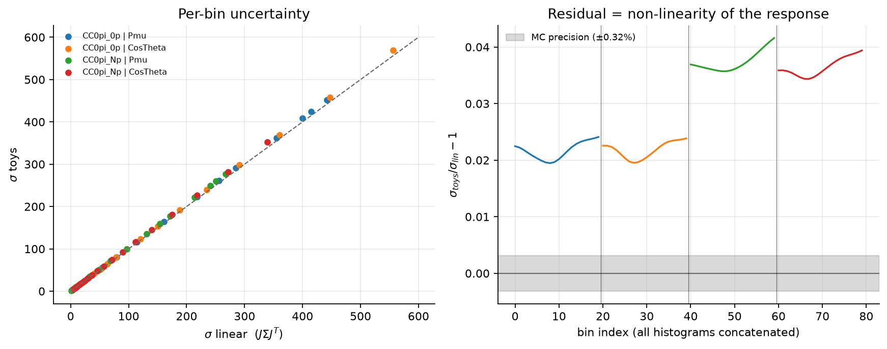
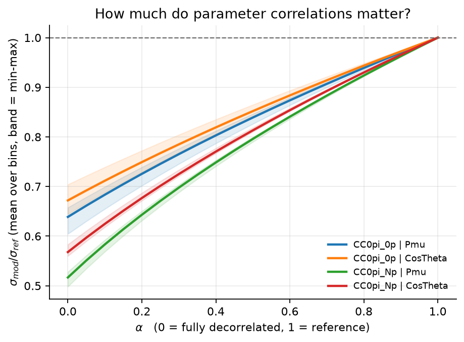
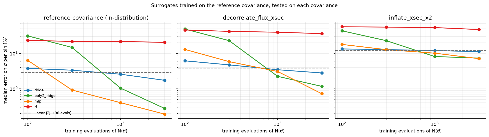
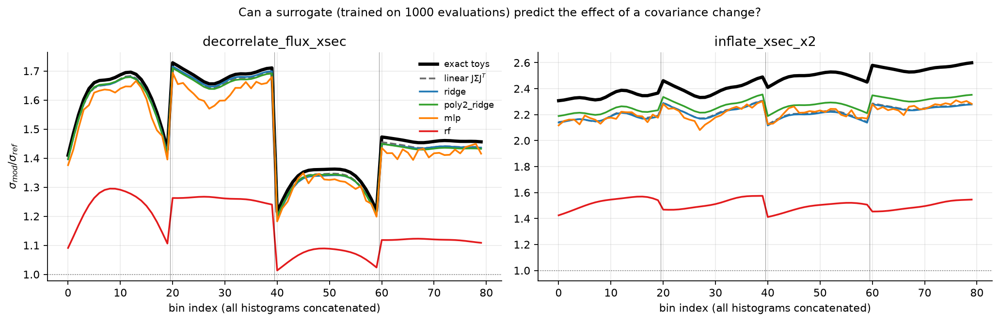

# covsens — how much do fit- systematic parameter correlations matter for binned predictions (in momentum and angle)?

[](https://github.com/<your-user>/fit-covariance-sensitivity/actions)

Given the best-fit values and covariance matrix of a fit with many nuisance parameters, **covsens** modifies the
covariance in controlled ways (decorrelate groups, interpolate correlations, inflate uncertainties) and measures,
bin by bin, how the uncertainty on the predicted histograms (momentum, angle) changes.


*Removing the flux↔cross-section anti-correlation inflates the prediction uncertainty by 20–72 % depending on the bin.*

## Why it matters

In near-detector fits (e.g. T2K-like analyses), flux, cross-section and detector parameters are fitted together and end up
correlated. Those correlations are what makes the predictions precise. This tool answers *"which bins would suffer
most if a correlation were wrong or neglected?"* in seconds, without rerunning the fit.

## Quickstart

```bash
pip install -e ".[dev]"
make demo      # generates the synthetic data, runs the analysis, writes figures + tables to outputs/
make test      # 22 tests
```

Everything is driven by [`configs/demo.yaml`](configs/demo.yaml); there are no hard-coded paths.

## What is real and what is synthetic

The repository ships **no collaboration data**. The demo runs on a *synthetic benchmark* (48 parameters in 3 groups,
2 samples × 2 variables × 20 bins) whose response $N(\theta)$ is known exactly. This is deliberate: with a known truth,
the propagation can be **validated**, which is impossible on an opaque real fit. Numbers below describe the benchmark,
not a real experiment. A real analysis would need a Jacobian or toys from the fitter; the loader in `io/readers.py` can be adapted to other file formats.

## Method in one picture

```
fit file  ->  (θ̂, Σ_ref)  ──►  transforms  ──►  Σ_mod  (decorrelate / interpolate α / inflate)
                 │                                  │
                 └──────► J = ∂N/∂θ at θ̂  ◄─────────┘
                          Σ_N = J Σ Jᵀ   (and Monte-Carlo toys via Cholesky, as a cross-check)
                                      │
                      σ_mod / σ_ref per bin, bin-bin correlations, variance by group
```

Details and maths: [`docs/method.md`](docs/method.md).

## Results (synthetic benchmark)

| Scenario | mean σ_mod/σ_ref | range |
|---|---|---|
| decorrelate flux ↔ xsec | **1.50** | 1.20 – 1.72 |
| decorrelate everything | 0.60 | 0.50 – 0.70 |
| half correlations (α = 0.5) | 0.83 | 0.79 – 0.87 |
| inflate xsec ×2 | 2.22 | 2.13 – 2.31 |
| inflate flux ×2 | 1.08 | 0.90 – 1.36 |
| inflate detector ×2 | 1.08 | 1.01 – 1.23 |
| *control: decorrelate flux ↔ det* | *1.000* | *1.000* |

**Take-aways**

1. The *direction* of the effect depends on the structure of the correlations, not on "correlation" in general.
   Removing all correlations *lowers* σ by ~40 % (same-sign sensitivities inside a group add coherently);
   removing only the flux↔xsec block *raises* it by ~50 % (their anti-correlation was cancelling the rate uncertainty).
2. The cancellation is visible directly in the variance decomposition below: group contributions sum to well above 100 %,
   the negative cross-group term brings the total back to 100 %.
3. The sensitivity is not uniform: the 0p sample is more affected (up to ×1.72) than the Np sample (×1.2–1.45).
4. The negative control (no such correlation in the reference) gives exactly 1, as it must.





### Validation: linear propagation vs Monte-Carlo toys

Both methods are run on every covariance. On the reference, the two agree to within 2–4 % on σ
(Monte-Carlo precision 0.3 %): the residual is the true non-linearity of the response, as expected.
The discrepancy grows when uncertainties are inflated (xsec ×2 leaves the linear regime), a case where toys should be preferred.





Parameter and bin-to-bin correlation heatmaps (reference / modified / difference) are in
`outputs/figures/02_*` and `03_*`; per-bin tables in `outputs/tables/`.

## Extension: can a machine-learning surrogate replace the response?

`pip install -e ".[ml]"` then `covsens surrogate`. In a real analysis one evaluation of N(θ) can be slow, so a cheap
model (Ridge, quadratic Ridge, MLP, random forest) is trained on a limited number of evaluations drawn from the
*reference* covariance. The question is whether it gives the right σ per bin, and the right σ_mod/σ_ref when the covariance
changes, judged against exact toys.



* **In-distribution** the MLP and the quadratic Ridge reach 0.2–0.3 % error on σ with 3000 evaluations,
  versus ~3 % for linear propagation (which needs only 96 evaluations).
* **Out-of-distribution** (xsec uncertainties doubled) every model is off by 7–12 %: a surrogate trained on the reference
  covariance has never seen those regions. Linear propagation is not better there, the response is simply no longer linear.
* **Random forests fail** (20–50 % error): trees cannot extrapolate and are poor on smooth 48-dimensional responses.
* With ≲ 300 evaluations, linear propagation beats every ML model.



Take-away: ML is not the core of this problem. It pays off only when the response is strongly non-linear *and* thousands
of evaluations are affordable; otherwise J Σ Jᵀ is cheaper and as accurate. Inputs and outputs are standardised for every model.

## Repository layout

```
configs/demo.yaml          scenarios, toy count, paths
src/covsens/
  data.py                  typed containers (FitResult, Dataset, Propagated)
  synthetic.py, response.py  benchmark with known ground truth
  io/readers.py            .npz loader
  covariance/transforms.py decorrelate, interpolate, inflate, nearest-PSD repair
  covariance/validation.py symmetry / PSD / conditioning checks
  propagation/linear.py    finite-difference Jacobian, J Σ Jᵀ
  propagation/toys.py      Cholesky sampling (eigh fallback), Monte-Carlo propagation
  metrics.py               σ ratios, per-bin tables, variance decomposition
  plotting/figures.py      all figures
  pipeline.py, cli.py      orchestration and command line
  extensions/surrogate.py  optional ML benchmark (needs scikit-learn)
tests/                     22 tests (analytic 2×2 case, PSD, linear-vs-toys, end-to-end)
docs/method.md             the maths
```

## Limitations and next steps

* Synthetic response; real data needs a real Jacobian or toys from the fitter.
* Gaussian parameters, linear propagation is first order (non-linearity quantified above).
* The surrogate benchmark uses one random seed; repeating it over seeds would add error bars.

## Author

Léna Osu — PhD in particle physics. MIT licence. Parts of the code were written with AI assistance and reviewed by the author.
